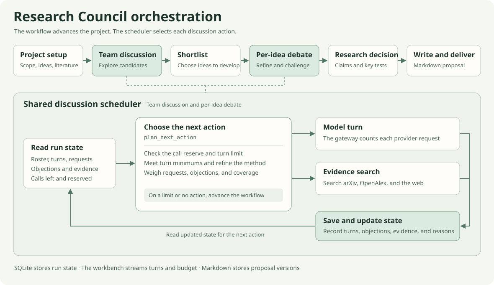

# Research Council

English · [简体中文](README.md)

**A local workbench for developing research ideas through multi-model debate.**

Give the council a research question, target venue, and resource constraints. Models propose ideas independently, discuss the trade-offs, and refine shortlisted ideas into Markdown proposals with a first validation plan or a paper-style draft.

[Quick start](#quick-start) · [Orchestration](#orchestration) · [Project layout](#project-layout)

## Quick start

Requires **Python 3.11+**, **Node.js 22.12+** (or Node.js 20.19+ on the 20.x release line), and npm. Run these commands from the repository root.

```sh
python -m venv .venv
```

Some macOS and Linux installations use `python3` to create the environment. Activate it in your shell.

| Shell | Activation command |
| --- | --- |
| bash / zsh | `source .venv/bin/activate` |
| PowerShell (Windows) | `.\.venv\Scripts\Activate.ps1` |
| Command Prompt (Windows) | `.venv\Scripts\activate.bat` |

```sh
python -m pip install -r backend/requirements.txt
npm --prefix frontend ci
npm --prefix frontend run build
python -m uvicorn backend.app.main:app --host 127.0.0.1 --port 8000
```

Open the [workbench](http://127.0.0.1:8000). To launch it again, activate the environment and run the last command.

<details>
<summary>Windows tip: install and launch with PowerShell scripts</summary>

```powershell
powershell -ExecutionPolicy Bypass -File .\scripts\setup.ps1
powershell -ExecutionPolicy Bypass -File .\scripts\start.ps1
```

Run the setup script once. The start script accepts `-Port 8010` to change ports and `-SkipBuild` to reuse a frontend build.

</details>

1. Add model profiles in Settings. Each profile has its own model ID, base URL, API key, context window, and API format (OpenAI Chat Completions or Anthropic Messages).
2. Choose the discussion roster and assign one model to each other task, such as proposing candidates, designing experiments, or writing.
3. Create a project and choose a deliverable, candidate count, minimum turns per member, and call limit. The live graph shows who is speaking and why the scheduler picked them.

| Deliverable | Contents |
| --- | --- |
| **Idea brief** (UI default) | Main claim, mechanism, first validation plan, open questions, and evidence |
| **Paper-style proposal** | Abstract, introduction, related work, method, experiments, expected results, limitations, and reproducibility plan |

Both deliverables export to Markdown. After a proposal is generated, use **Continue discussion** to request changes, share experimental observations, or upload a report. A revision creates a new version of the idea and preserves the original and the revision notes.

## Orchestration



Independent proposals and an initial literature search feed into a team discussion. Models can branch or combine proposals. A designated lead shortlists ideas, and the team debates each one separately. The recorded claim and mechanism guide method design, experiment planning, and writing.

- **Dynamic debate.** A shared, rule-based scheduler reads turn counts, requests to respond, unresolved objections, candidate coverage, and remaining calls. It decides who acts and whether to explore a candidate, address an objection, develop a method, or look for evidence. It records why each discussion ends.
- **Shared research state.** Turns, objections and responses, literature evidence, and decisions are stored separately so later stages can pick up a specific question. Context is scoped to the run or idea, with compression and pause/resume support. Researchers can add guidance, constraints, evidence, or decisions to the next model request using **Join discussion**.
- **Live orchestration graph.** The workbench shows the current speaker, who requested a response, and why the scheduler chose each action. Past actions link to the corresponding turns, and search results appear in the discussion.

**Call budget.** The gateway counts provider requests, including retries, JSON repairs, and model-generated summaries. The scheduler reserves calls for delivery. You can raise the limit during a run or resume an exhausted run by raising it. The workbench records each increase.

## Literature, Skills, and storage

- **Literature** comes from arXiv, OpenAlex, and the web. Evidence checks take place during discussion, and source links stay with the discussion and proposal.
- **Skills** are local `SKILL.md` instructions. Research and writing have separate sets, and each run saves the excerpts it used.
- **Local data** defaults to `data/`. SQLite stores run state, messages, and call records. Markdown drafts and experiment reports live under `data/projects/`, and model settings live in `data/settings.json`. Set `DATA_DIR` in `.env` to change the storage location.
- **Scope** is a local, single-user workbench for planning and writing. Researchers run the proposed training and evaluation themselves.

## Project layout

| Path | Responsibility |
| --- | --- |
| [`engine.py`](backend/app/services/engine.py) | Workflow stages, budget reservations, versioning, and recovery |
| [`orchestrator.py`](backend/app/services/orchestrator.py) | Choose the next discussion action |
| [`research_state.py`](backend/app/services/research_state.py) | Turns, objections, evidence, and research decisions |
| [`model_gateway.py`](backend/app/services/model_gateway.py) | Provider APIs, streaming, and hard call limits |
| [`frontend/src/`](frontend/src/) | React workbench, live scheduling graph, and document viewer |
| [`specs/`](specs/) | Research guidelines, debate protocol, and document template |

With the virtual environment active, run the backend tests and build the frontend.

```sh
python -m pytest -q
npm --prefix frontend run build
```

Inspired by [OrchDebate](https://aclanthology.org/2026.emnlp-main.2078/) (Zhou et al., EMNLP 2026).

