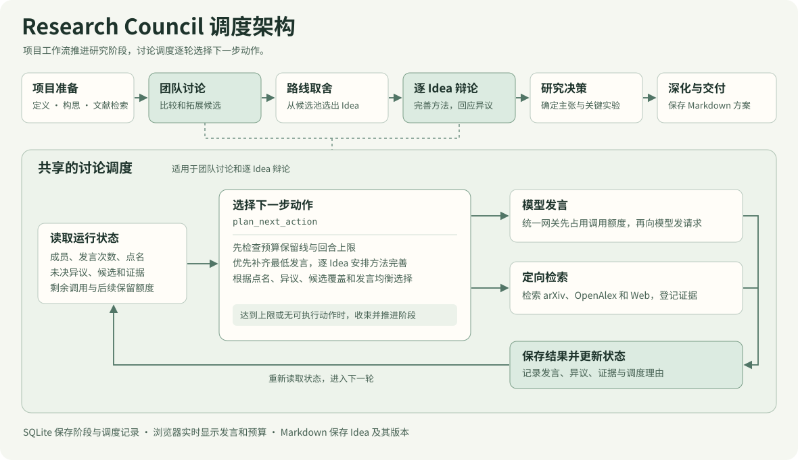

# Research Council

[English](README-EN.md) · 简体中文

**一个让多个 LLM 一起构思、辩论并写出科研方案的本地工作台。**

输入研究问题、目标会议和资源约束。模型先独立提出候选，再围绕问题价值、方法机制和关键对照展开讨论。入选路线逐个深化，最后交付带首轮验证计划的 Markdown 方案，也可以写成论文式初稿。

[快速启动](#快速启动) · [调度架构](#调度架构) · [项目结构](#项目结构)

## 快速启动

环境需要 **Python 3.11+**、**Node.js 22.12+**（或 Node.js 20.19 及以上的 20.x）和 npm。以下命令均在项目根目录运行。

```sh
python -m venv .venv
```

部分 macOS 或 Linux 环境使用 `python3`。创建后按当前 Shell 激活虚拟环境。

| Shell | 激活命令 |
| --- | --- |
| bash / zsh | `source .venv/bin/activate` |
| PowerShell（Windows） | `.\.venv\Scripts\Activate.ps1` |
| Command Prompt（Windows） | `.venv\Scripts\activate.bat` |

```sh
python -m pip install -r backend/requirements.txt
npm --prefix frontend ci
npm --prefix frontend run build
python -m uvicorn backend.app.main:app --host 127.0.0.1 --port 8000
```

打开 [本地工作台](http://127.0.0.1:8000)。日常启动时，激活虚拟环境后运行最后一条命令即可。

<details>
<summary>Windows 提示：用 PowerShell 脚本安装和启动</summary>

```powershell
powershell -ExecutionPolicy Bypass -File .\scripts\setup.ps1
powershell -ExecutionPolicy Bypass -File .\scripts\start.ps1
```

首次运行安装脚本即可。启动脚本支持 `-Port 8010` 切换端口和 `-SkipBuild` 复用前端构建。

</details>

1. 打开「模型团队」，逐个填写模型 ID、Base URL、API Key 和上下文窗口。接口可选 OpenAI Chat Completions 或 Anthropic Messages。
2. 勾选讨论成员，为负责人、独立构思、方法设计、实验设计和写作等任务各指定一个模型。
3. 新建项目，设置交付类型、候选数、最低发言次数和调用上限。启动后可在调度图里查看当前发言者、点名关系和调度理由。

| 交付类型 | 文档内容 |
| --- | --- |
| **Idea 方案与首轮验证**（界面默认） | 中心主张、核心机制、首轮实验、未决问题和相关证据 |
| **论文式方案** | 摘要、引言、相关工作、方法、实验、预期结果、局限和复现计划 |

两种文档都可导出 Markdown。方案生成后，可在讨论页点「继续讨论」，提出修订要求、补充实验结果或上传报告。修订会从当前 Idea 生成新版本，并保留原方案和修订说明。

## 调度架构



外层工作流依次推进项目定义、独立构思、初步文献检索和团队讨论。团队可以分出新路线或合并候选，负责人选择值得深化的 Idea。入选路线逐个辩论，再以记录下来的主张和机制为依据完成方法、实验设计与写作。

- **动态辩论。** 团队讨论与逐 Idea 辩论共用规则调度器。它根据参与次数、点名、未决异议、候选覆盖和剩余调用，决定谁发言以及要做什么。动作包括探索候选、回应异议、补全方法和定向检索。到达回合或预算保留线、没有可执行动作时，调度器记录收束原因。
- **共享研究状态。** 发言、异议与回应、文献证据和研究决策分别保存，后续阶段可以接着处理同一问题。上下文按项目阶段或 Idea 组织，支持压缩和暂停恢复。研究者也能在运行中通过「加入讨论」提交方向、约束、证据或决策，输入排队进入下一次模型请求。
- **过程可视化。** 实时调度图显示当前发言者、点名关系和动作理由。可以回看历史动作并跳转到对应发言，文献检索结果也会随讨论广播。

**调用预算**由模型网关统一计数，包括失败重试、JSON 修复和模型摘要。调度器给后续交付预留调用。运行中可以提高上限，耗尽后加预算会继续运行，每次变更都可以回看。

## 文献、Skills 与本地数据

- **文献**从 arXiv、OpenAlex 和 Web 获取标题与可用摘要。检索和证据核对贯穿讨论，来源随记录和方案保留。
- **Skills** 可从设置页指定本地 `SKILL.md` 目录。讨论和写作分别配置技能包，启动时保存实际注入的摘录，恢复时复用。
- **数据**默认保存在 `data/`。`app.db` 记录阶段、消息和调用，`projects/` 保存 Markdown、讨论日志和反馈，`settings.json` 保存本机模型配置。可用 `.env` 中的 `DATA_DIR` 修改目录。
- **部署范围**为本机单用户工作台。系统负责生成研究方案，训练和评估由研究者执行。

## 项目结构

| 路径 | 职责 |
| --- | --- |
| [`engine.py`](backend/app/services/engine.py) | 阶段推进、预算保留、版本保存和暂停恢复 |
| [`orchestrator.py`](backend/app/services/orchestrator.py) | 选择下一步讨论动作 |
| [`research_state.py`](backend/app/services/research_state.py) | 发言、异议、证据和研究决策 |
| [`model_gateway.py`](backend/app/services/model_gateway.py) | 模型接口、流式输出和调用上限 |
| [`frontend/src/`](frontend/src/) | React 工作台、实时调度图和文档查看 |
| [`specs/`](specs/) | 研究约定、辩论协议与文档模板 |

激活虚拟环境后，运行以下命令验证后端和前端构建。

```sh
python -m pytest -q
npm --prefix frontend run build
```

调度设计受到 [OrchDebate](https://aclanthology.org/2026.emnlp-main.2078/)（Zhou 等，EMNLP 2026）的启发。

